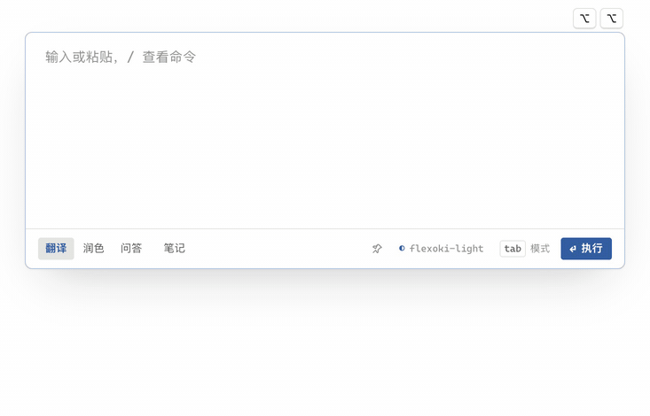
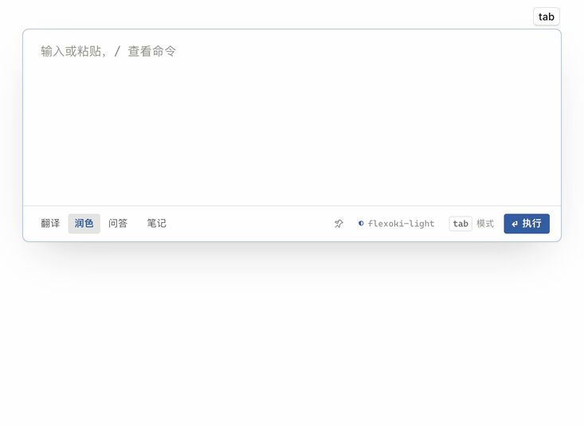
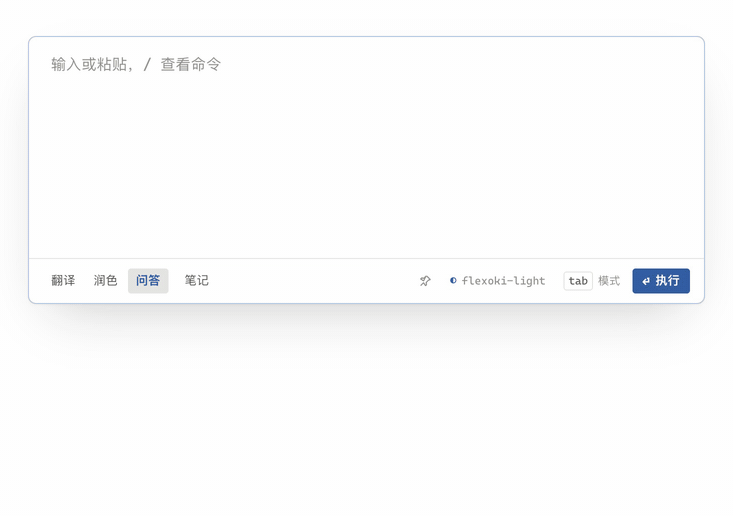
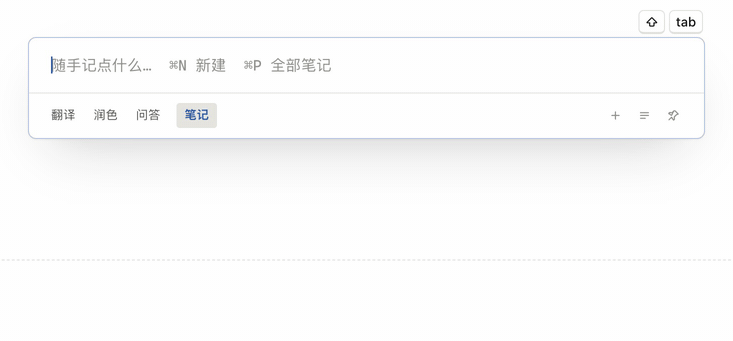
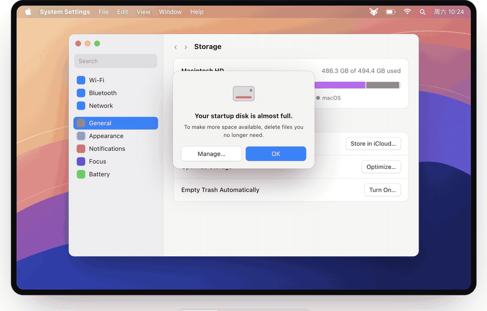
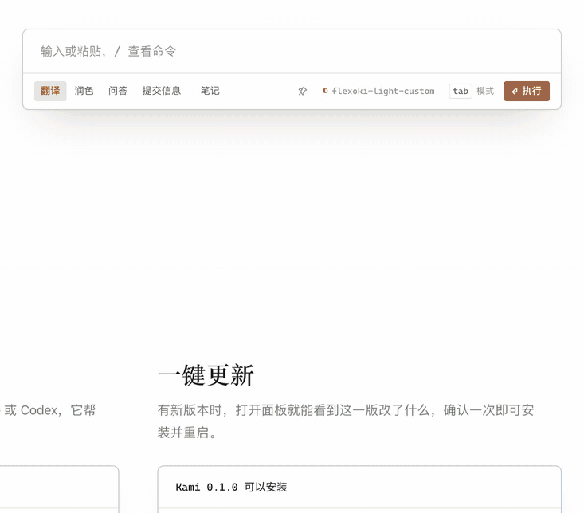
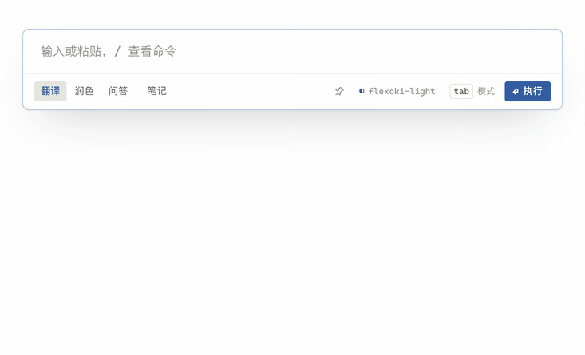
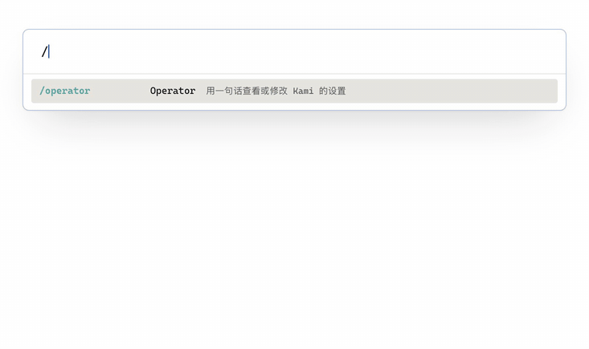
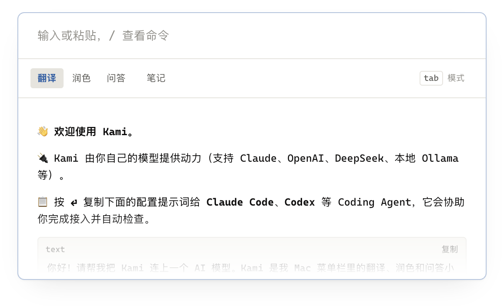

  

<h1 align="center">Kami</h1>

100% Go · GPU 实时绘制 · 9 MB 安装包 · 流畅体验

<h3 align="center">一个快捷键，把手头的文字交给你的大模型。</h3>

  <a href="https://umupa.github.io/Kami/">官网与交互演示</a>
  &nbsp;·&nbsp;
  <a href="https://github.com/Umupa/Kami/releases/latest"><b>下载 Kami</b></a>
  &nbsp;·&nbsp;
  <code>brew install --cask umupa/kami/kami</code>

需要 macOS 15.2 或更新版本

## 功能

<table>
  <tr>
    <td width="33%" valign="top">
      <h3>划词翻译</h3>
      
双击 ⌥ 翻译选中文字，支持追问。

      
    </td>
    <td width="33%" valign="top">
      <h3>润色整理</h3>
      
润色文字，整理标题、列表和表格。

      
    </td>
    <td width="33%" valign="top">
      <h3>随时问答</h3>
      
⌥Space 打开面板，随时提问。

      
    </td>
  </tr>
  <tr>
    <td width="33%" valign="top">
      <h3>随手记</h3>
      
多条笔记，停下就自动保存成 Markdown。

      
    </td>
    <td width="33%" valign="top">
      <h3>截屏翻译</h3>
      
⌥S 框选界面、字幕或图片，识别并翻译。

      
    </td>
    <td width="33%" valign="top">
      <h3>内置主题</h3>
      
18 套配色，<code>/theme</code> 边选边预览。

      
    </td>
  </tr>
  <tr>
    <td width="33%" valign="top">
      <h3>自定义模式</h3>
      
用 <code>/operator</code> 添加自己的模式。

      
    </td>
    <td width="33%" valign="top">
      <h3>自定义配色</h3>
      
基于内置主题调整颜色，⌘Z 随时撤销。

      
    </td>
    <td width="33%" valign="top">
      <h3>配置交给 Agent</h3>
      
把提示词交给 Agent，接好自己的模型。

      
    </td>
  </tr>
</table>

  Kami 是日语里的「纸」。 · <a href="https://github.com/Umupa/Kami/blob/main/CHANGELOG.md">更新记录</a> · <a href="LICENSE">Apache-2.0</a>
   
  灵感来自 <a href="https://cida.xuanwo.io/">辞达</a>，用 <a href="https://github.com/egoist/mygo">MyGo</a> 构建。

