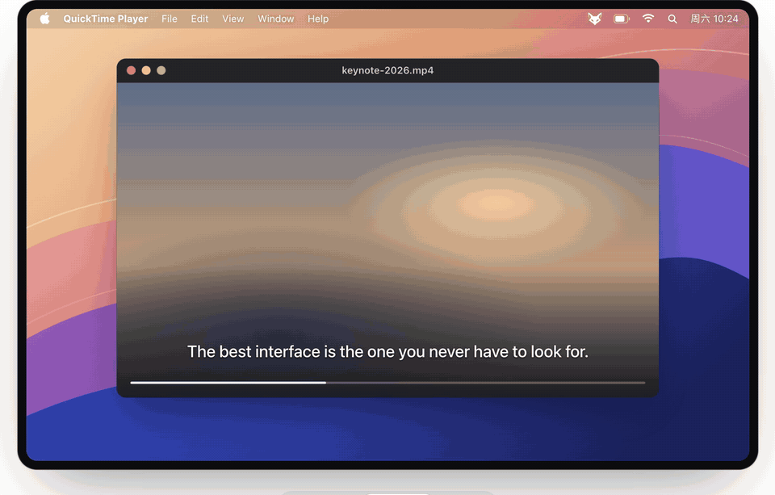
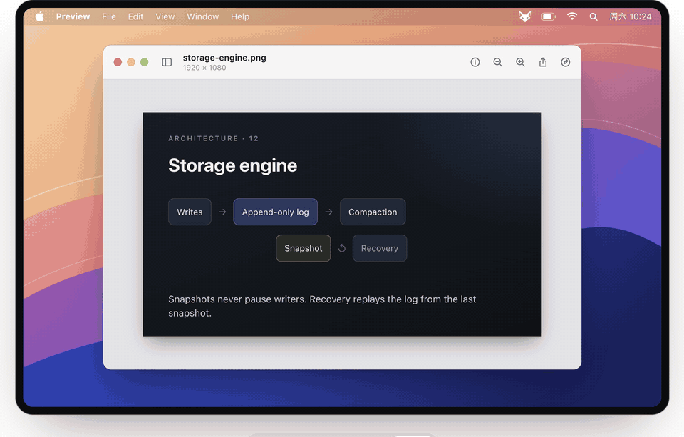
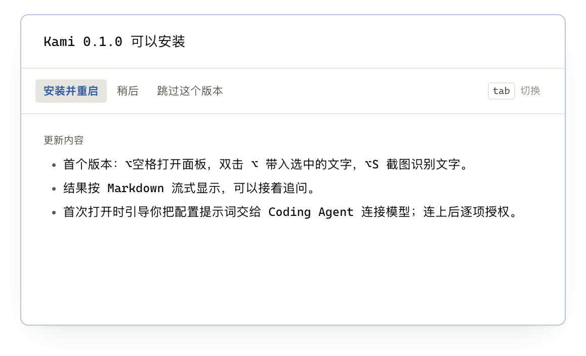

<p align="center">
  
</p>

<h1 align="center">Kami</h1>

<p align="center">100% Go · GPU 实时绘制 · 9 MB 安装包 · 流畅体验</p>

<h3 align="center">一个快捷键，把手头的文字交给你的大模型。</h3>

<p align="center">
  <a href="https://github.com/Umupa/Kami/releases/latest"><b>下载 Kami</b></a>
  &nbsp;·&nbsp;
  <a href="#把文字交给-kami">交给 Agent 安装</a>
  &nbsp;·&nbsp;
  <code>brew install --cask umupa/kami/kami</code>
</p>

<p align="center">需要 macOS 15.2 或更新版本</p>

<table align="center">
  <tr>
    <td align="center"><kbd>⌥</kbd> <kbd>Space</kbd><br><sub>打开面板</sub></td>
    <td align="center">双击 <kbd>⌥</kbd><br><sub>翻译选中的文字</sub></td>
    <td align="center"><kbd>⌥</kbd> <kbd>S</kbd><br><sub>截屏翻译</sub></td>
  </tr>
</table>

## 选中文字，双击 ⌥

不用复制，也不用切换应用：译文立刻出现，外文译成中文，中文译成英文。


## 杂乱的文字，一键理清

改通顺，顺带整理成标题、列表和表格。


## AI Chat

简单的问题，随时问随时答：<kbd>⌥</kbd> <kbd>Space</kbd> 唤起，<kbd>⏎</kbd> 就有回答，不用另开聊天窗口。


## 随手记一笔

功能类似 Raycast Notes，但不限条数；停下就自动保存成 Markdown。


## 在 Mac 的任何地方，翻译和润色文字

按 <kbd>⌥</kbd> <kbd>S</kbd> 框选任意一块，在本机识别后直接翻译。


<table>
  <tr>
    <td></td>
    <td></td>
  </tr>
  <tr>
    <td align="center"><sub>视频字幕</sub></td>
    <td align="center"><sub>图片</sub></td>
  </tr>
</table>

## 加一个自己的模式

输入 `/operator`，说一句话，配置就改好了。


## 调一套自己的配色

基于任意一套内置主题，只改想改的颜色；<kbd>⌘</kbd> <kbd>Z</kbd> 随时撤销。


## 内置多种主题

18 套配色，`/theme` 边选边预览。


<table>
  <tr>
    <td width="50%" valign="top">
      <h3>配置交给 Agent</h3>
      <p>第一次打开，把面板里的提示词交给 Claude Code 或 Codex，它帮你接好模型。</p>
      
    </td>
    <td width="50%" valign="top">
      <h3>一键更新</h3>
      <p>有新版本时，打开面板就能看到这一版改了什么，确认一次即可安装并重启。</p>
      
    </td>
  </tr>
</table>

## 把文字交给 Kami

<p>
  <a href="https://github.com/Umupa/Kami/releases/latest"><b>下载 Kami</b></a>
</p>

```sh
brew install --cask umupa/kami/kami
```

<details>
<summary><b>交给 Agent 安装</b></summary>

<!-- agent-prompt -->
````text
你好！请帮我在这台 Mac 上安装 Kami，再把它连上一个 AI 模型。Kami 需要 macOS 15.2 或更新版本。

## 先装好 Kami（不用问我）

1. 用 `curl -s https://api.github.com/repos/Umupa/Kami/releases/latest` 找到最新版本，按 `uname -m` 选 DMG：arm64 选名字以 `.arm64.dmg` 结尾的，x86_64 选以 `.amd64.dmg` 结尾的。没有对应的 DMG 就停下，告诉我这台 Mac 暂时还不能用。
2. 下载到临时目录，用 `hdiutil attach -nobrowse` 挂载，把 Kami.app 复制到 /Applications（已经装过的话，先退出 Kami 再替换），然后卸载 DMG、删掉临时文件。
3. 用 `open -a Kami` 打开一次。Kami 只在菜单栏显示一只小狐，第一次打开时会写出下面说到的配置文件和字段说明。

装好后，照下面这段说明帮我接上模型。路径里的 ~ 是我的用户目录。

---

你好！请帮我把 Kami 连上一个 AI 模型。Kami 是我 Mac 菜单栏里的翻译、润色和问答小工具，只需要一个又快又便宜的模型。

Kami 的命令行：'/Applications/Kami.app/Contents/MacOS/Kami'
（下文的 `Kami` 都指它，请用带引号的绝对路径运行）
配置文件：'~/Library/Application Support/Kami/config.json'
字段说明：'~/Library/Application Support/Kami/config.schema.json'

和我说话时请用大白话，一次只问一个问题，给编号选项让我回数字。需要我动手时，告诉我点哪里，然后等我说「好了」。

## 先看看现在的情况（不用问我）

读字段说明和配置文件，再运行 `Kami check`，按结果走：
- 还没有配置模型 → 带我从头配置（见下一节）
- 配置文件有问题 → 直接修好，不用问我
- 缺 API Key → 按下面「规矩」里的办法请我复制
- 请求失败 → 运行 `Kami check --verbose` 看实际的请求和回应，找到原因就修；需要我换服务、充值或重新登录时再问我
- 已经可用 → 告诉我一声，问我想调整什么

## 从头配置

先自己看一眼：有没有装 magpie、127.0.0.1:3425 有没有在运行、有没有 Ollama 或 LM Studio 在运行。然后问我手上有哪种，结合你看到的情况推荐一个：

1. 某家服务的 API Key（OpenAI、Anthropic、DeepSeek、Kimi、智谱……）
2. 没有 Key，但有订阅：Claude、ChatGPT / Codex、GitHub Copilot、Gemini 等
3. 本机跑的模型（Ollama、LM Studio）
4. 都没有，或者不确定

你现在运行所用的订阅或 Key，多半就能拿来用，可以提醒我这一点。

- 选 1：问是哪家，查它的官方文档，确定接口，选这家最便宜、最快的那档模型。
- 选 2：用 magpie（https://github.com/yetone/magpie）在本机把订阅变成接口。先用一句话说明它是什么，我同意后再安装。在 magpie 里登录订阅由我自己来，你告诉我怎么做。然后把 Kami 指向 http://127.0.0.1:3425，按下面「选模型」挑一个。顺便提醒我三件事：Kami 用的是这份订阅的额度；用 Kami 时 magpie 要开着；有些服务商不允许把订阅用在别的工具里，由我自己判断。
- 选 3：指向本机的接口，auth 设为 none。
- 选 4：从 DeepSeek、OpenAI 的 GPT mini / nano、`gpt6-luna` 这类低价模型里推荐两三个，每个一句话说清价格和差别，让我选。

## 选模型

Kami 的请求多而短，价格和速度比能力重要。优先选便宜、快、不带思考的模型，比如 DeepSeek、GPT 的 mini / nano 系列、`gpt6-luna`。Claude Haiku 这类模型单价高出不少，除非我点名要，不要默认选它；订阅里能选的模型也按这个顺序挑。

## 规矩

- 只改配置文件里的 model，别的设置不动；我选好的服务和模型不擅自更换。保存后 Kami 立即生效，不用重启。
- Kami 只做翻译、润色和简短问答，用不上思考：能关就在 model.body 里关掉，关不掉就设到最低档。
- API Key 别让我发给你，也别打印出来或写进别的文件。需要时请我先复制，你用 pbpaste 读出来，直接写进 model.apiKey。已有的 Key 不用重新要。
- 每次改完运行 `Kami check`。同一个做法失败了就换思路，别反复重试。

## 最后

用一两句话告诉我结果：能不能用、还要我做什么，不讲技术细节。能用的话告诉我：回到 Kami，按 ⌥Space 打开面板，输入一段文字按 ⏎ 试一次。

如果你没法在这台 Mac 上运行命令，请直接告诉我：需要一个能在本机运行命令的 Coding Agent。
````
<!-- /agent-prompt -->

</details>

需要 macOS 15.2 或更新版本

<p align="center">
  <sub>Kami 是日语里的「纸」。 · <a href="https://github.com/Umupa/Kami/blob/main/CHANGELOG.md">更新记录</a> · <a href="LICENSE">Apache-2.0</a> · 用 Go 和 <a href="https://github.com/egoist/mygo">MyGo</a> 编写</sub>
</p>
